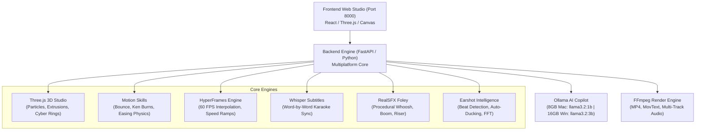

# 🎬 super_ai_editor

> **The Next-Generation AI Video Editing Studio** powered by **Three.js**, **Motion Skills**, **HyperFrames**, **Whisper**, **RealSFX**, **Earshot**, and **Ollama**.

[-blue.svg?logo=docker)](file:///Users/rajatchatur/Desktop/super-ai_editor/docker-compose.yml)
[](file:///Users/rajatchatur/Desktop/super-ai_editor/INSTALL.md)
[](file:///Users/rajatchatur/Desktop/super-ai_editor/INSTALL.md)
[](file:///Users/rajatchatur/Desktop/super-ai_editor/verify_system.py)

---

## 🌟 Overview

**`super_ai_editor`** is a high-performance, dark-themed, desktop-grade video editing application engineered to run with zero friction in Docker across **macOS** (Apple Silicon M1–M4 & Intel) and **Windows 10 / 11**. 

It unifies cutting-edge 3D compositing, procedural Foley synthesis, speech-to-text subtitling, acoustic intelligence, and local LLM video editing copilots into an intuitive multi-track timeline.



---

## ⚡ Core Subsystems & Capabilities

| Subsystem | What It Does | Features |
| :--- | :--- | :--- |
| **Three.js** | **3D Visual Effects & Compositing** | Real-time WebGL 3D text extrusions, 10,000-particle cosmic vortex, holographic cyber rings, customizable lighting & metalness. |
| **Motion Skills** | **Kinetic Typography & Physics Easing** | Snappy elastic bounce entries, cinematic Ken Burns slow zoom, lower third newsroom banners, chromatic aberration glitch. |
| **HyperFrames** | **Frame-Accurate Video Processing** | 60 FPS motion-compensated frame interpolation (`minterpolate`), pitch-corrected speed ramping (0.1x to 10x), SMPTE frame-by-frame scrubbing. |
| **Whisper** | **Speech-to-Text & Auto-Subtitling** | Timestamped audio-synchronized speech transcription, Hormozi / MrBeast active word highlight style, Cyberpunk neon glow, 1-click `.SRT` export. |
| **RealSFX** | **Realistic Foley & Procedural SFX** | Procedural mathematical wave synthesis (Whoosh, Boom, Riser, Laser, Pop, Glitch) + library of pre-rendered studio Foley sounds. |
| **Earshot** | **Acoustic Intelligence & Auto-Ducking** | Real-time FFT frequency spectrum analyzer, BPM tempo beat onset markers, automatic background music ducking (-14dB) during dialogue. |
| **Ollama Copilot** | **Hardware-Tailored Video AI Assistant** | Auto-detects RAM & OS: recommends **`llama3.2:1b`** for **8GB Mac** and **`llama3.2:3b`** for **16GB Windows**. Converts natural language to timeline actions. |

---

## 🚀 Quick Start (Choose Your Preferred Method)

### Option 1: Docker (Recommended for macOS & Windows 10/11)

No installation of Python or Node required on your host machine:

```bash
# Clone or navigate to the directory
cd super-ai_editor

# Start the application
docker compose up --build
```

Then open your browser to: **[http://localhost:8000](http://localhost:8000)**

*(Optional: To run Ollama directly inside Docker alongside the editor, run: `docker compose --profile with-ollama up`)*

---

### Option 2: Native 1-Click Launchers

#### On macOS & Linux:
```bash
./start.sh
```
*Automatically detects your Apple Silicon or Intel CPU, reads system RAM, checks Ollama connectivity, and opens your default browser.*

#### On Windows 10 & 11:
Double-click **`start.bat`** or run:
```cmd
start.bat
```

---

## 🧠 Hardware RAM Profiles & Ollama Models

`super_ai_editor` features a built-in hardware detection engine (`/api/system/profile`) that automatically benchmarks your machine and recommends the sweet-spot model:

| Hardware Profile | Target Memory | Recommended Model | Benefits |
| :--- | :--- | :--- | :--- |
| **macOS 8GB Optimized** | **8 GB RAM** | `llama3.2:1b` | Ultra-fast inference on Apple Silicon Unified Memory (~1.3 GB footprint). Zero memory pressure, instant timeline action responses. |
| **Windows 16GB High-Performance** | **16 GB RAM** | `llama3.2:3b` | Balanced power for multi-core PCs. Rich contextual reasoning, handles complex editing scripts without paging to disk. |
| **Workstation 32GB+** | **32 GB+ RAM** | `mistral:7b` / `qwen2.5:7b` | Deep script analysis, creative title suggestion, and multi-scene structuring. |

### Pulling Your Recommended Model
In a separate terminal or command prompt:
```bash
# For 8GB macOS users:
ollama run llama3.2:1b

# For 16GB Windows users:
ollama run llama3.2:3b
```
> **Note**: Even if Ollama is not currently installed or offline, `super_ai_editor` has a **built-in offline AI rule engine** that will continue interpreting editing prompts and generating timeline actions without throwing any errors!

---

## 🎬 User Interface Guide

```
+-----------------------------------------------------------------------------------+
|  [Logo] super_ai_editor   [macOS (8GB) • llama3.2:1b]   [Demo]  [AI Copilot]  [Export] |
+-----------------------+----------------------------------+------------------------+
|  STUDIO PANELS        |  PREVIEW STAGE                   |  AI COPILOT DRAWER     |
|  [3D] [Motion]        |  +----------------------------+  |  "Add 3D spinning text |
|  [Whisper] [RealSFX]  |  | Layer 1: Base Video        |  |   'SUPER AI' with      |
|  [Earshot] [Media]    |  | Layer 2: Three.js 3D Mesh  |  |   whoosh sound effect" |
|                       |  | Layer 3: Subtitles / Motion|  |                        |
|  * 3D Text Controls   |  +----------------------------+  |  [✓ 2 Actions Applied] |
|  * SFX Synthesizer    |  [<<]  [ > ]  [>>]  00:00:02:14  |                        |
+-----------------------+----------------------------------+------------------------+
|  MULTI-TRACK TIMELINE (V1, 3D, M1, CC, FX)                                        |
|  [00:00]-------------|-----------------------[00:04]-----------------------[00:06]|
|  V1: [ Studio Ambient Base Clip ................................................ ]|
|  3D: [ 3D Title: SUPER AI ]        [ 3D Cyber Rings ]                             |
|  M1: [ Elastic Bounce ]            [ Ken Burns Zoom ............................ ]|
|  CC: [ "EXPERIENCE THE NEXT ERA" ] [ "POWERED BY THREE.JS AND WHISPER" ]          |
|  FX: [Whoosh] [Boom]               [Riser ..................................... ] |
+-----------------------------------------------------------------------------------+
```

### Studio Panels
1. **Three.js 3D Studio**:
   - Customize 3D extruded title text, mesh presets (Extruded Text, Cyber Particle Vortex, Hologram Rings, Crystalline Monolith).
   - Adjust lighting, colors, and rotation speed.
   - Click **Add 3D Element to Timeline**.
2. **Motion Skills**:
   - Select kinetic animation presets: **Elastic Bounce**, **Ken Burns Zoom**, **Slide & Fade Up**, or **RGB Glitch**.
   - Applies frame-by-frame easing curves to the preview stage.
3. **Whisper Subtitles**:
   - Click **Auto-Transcribe with Whisper**.
   - Select caption style: **Hormozi / MrBeast** (bold uppercase with dynamic active-word scaling & yellow pop), **Cinematic Minimalist**, or **Cyberpunk Neon**.
   - Edit subtitle text directly in real-time or export standard `.SRT` files.
4. **RealSFX Sound Studio**:
   - Instant playback for built-in Foley sounds: Whoosh, Impact Boom, Tension Riser, Laser Zap, Modern UI Pop.
   - Enter any prompt into the **Procedural SFX Generator** (e.g. *"heavy sub bass drop"*) to synthesize a custom WAV file on the fly!
5. **Earshot Audio Intelligence**:
   - Watch the live **FFT Frequency Spectrum Analyzer** react to audio.
   - View detected tempo (**BPM**).
   - Click **Apply Ducking** to automatically lower music volume by -14dB during speech blocks.
   - Click **Cut Silence** to automatically remove silent pauses (>0.4s).
6. **Ollama AI Copilot**:
   - Click the top **AI Copilot** button.
   - Chat in natural language: e.g. *"Add whoosh sound effect at 1s and auto-duck background audio"*.
   - The AI responds and instantly generates and executes timeline actions!

---

## ⌨️ Keyboard Shortcuts

| Shortcut | Action |
| :--- | :--- |
| **`Space`** | Play / Pause video playback |
| **`←` (Left Arrow)** | Step backward 1 frame (HyperFrames precision) |
| **`→` (Right Arrow)** | Step forward 1 frame (HyperFrames precision) |
| **`S`** | Split selected clip at playhead position |
| **`Delete` / `Backspace`** | Remove selected clip from timeline |

---

## 🧪 Comprehensive Verification Suite

To run the automated test suite testing all 8 subsystems:

```bash
python3 verify_system.py
```

Output:
```
=================================================================
🎬  super_ai_editor — Comprehensive System Verification
=================================================================
[TESTING] Hardware RAM Profile & Ollama Model Recommender... ✔ PASS
[TESTING] RealSFX Sound Effects Procedural Synthesizer...    ✔ PASS
[TESTING] Earshot Audio Intelligence & Auto-Ducking Engine...✔ PASS
[TESTING] Whisper Speech-to-Text & Subtitle Synchronization...✔ PASS
[TESTING] HyperFrames Video Processing Engine...              ✔ PASS
[TESTING] Ollama AI Video Editing Copilot & Offline Fallback..✔ PASS
[TESTING] FFmpeg Video Rendering & Export Pipeline...         ✔ PASS
[TESTING] Frontend Studio UI & Three.js Canvas Overlay Assets.✔ PASS
=================================================================
🎉 ALL 8 TESTS PASSED SUCCESSFULLY!
```

---

## 📄 License
MIT License. Built for creators by the super_ai_editor team.
